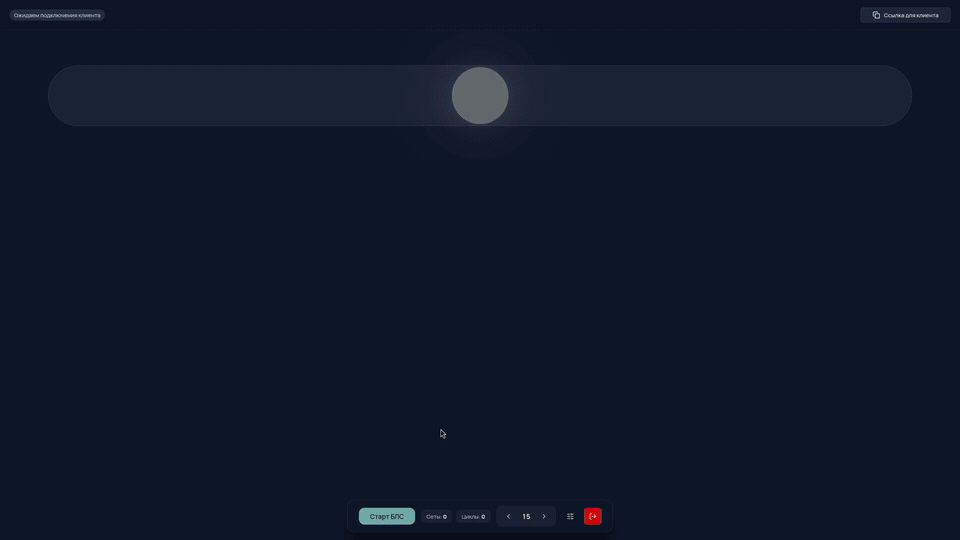
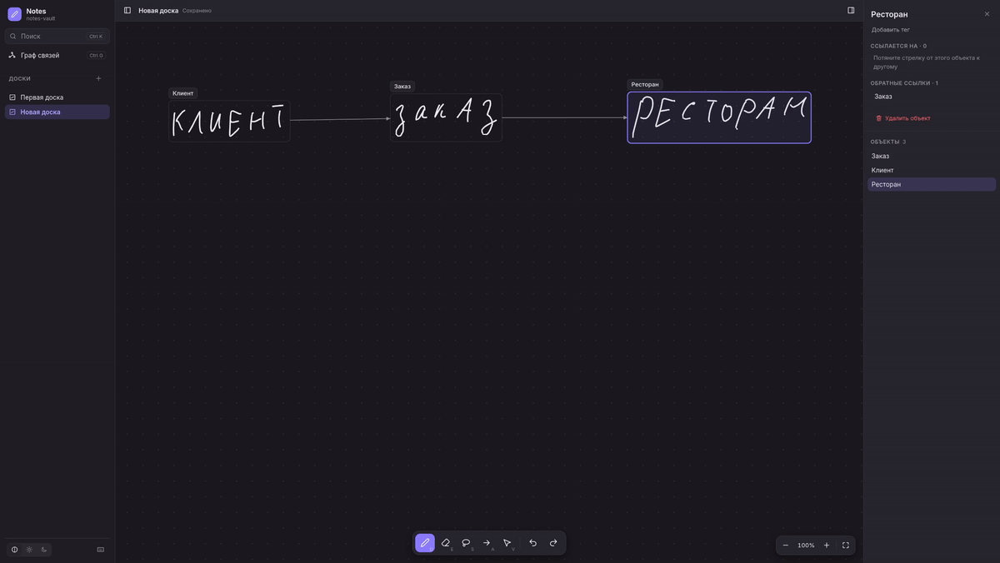

## Tools

  &nbsp;
  &nbsp;
  &nbsp;
  &nbsp;
  &nbsp;
  &nbsp;
  &nbsp;
  &nbsp;
  &nbsp;
  

**[I use arch, btw](https://wiki.archlinux.org/)**

## Projects

- **[Saccada](https://saccada.org)** — Web app for EMDR therapy sessions. Visual bilateral stimulation, session controls and progress ratings.

  

- **[SelfHostedEnv](https://github.com/FoXeNe/SelfHostedEnv)** — My self-hosted setup: Docker Compose, Ansible, reverse proxy, authentication, monitoring, Git hosting and backups.
- **[Ligature](https://github.com/FoXeNe/Ligature)** — Desktop app for handwritten notes and linking them together. Tauri, Rust, Svelte and SQLite.

  

- **[Syspect](https://github.com/FoXeNe/Syspect)** — Linux diagnostics CLI. Work in progress.

